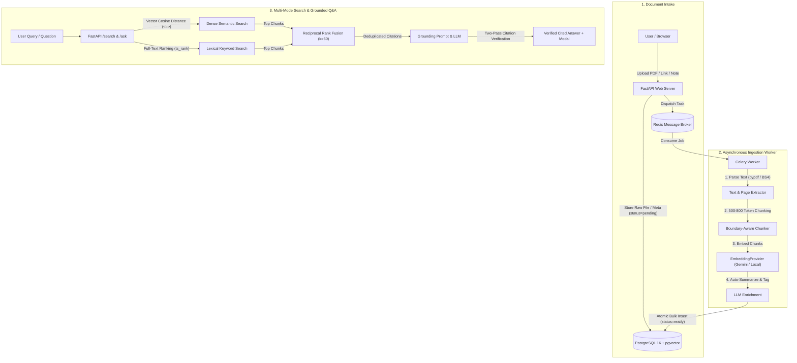

# RecallBox

[](https://github.com/your-org/recallbox/actions/workflows/ci.yml)
[](https://fastapi.tiangolo.com)
[](https://python.org)
[](https://github.com/pgvector/pgvector)
[](https://react.dev)
[](https://vitejs.dev)
[](https://tailwindcss.com)

**Personal Knowledge Base with Multi-Mode Retrieval (Semantic + Keyword Hybrid) and Grounded, Cited Q&A (RAG).**

RecallBox solves the universal problem of digital knowledge fragmentation: we save PDFs, bookmark tutorials, and write notes, but cannot retrieve information when we only remember concepts rather than exact keywords. 

RecallBox parses, chunks, and indexes user content into dual-vector/lexical stores (PostgreSQL + pgvector). It executes **Reciprocal Rank Fusion (RRF)** hybrid search across dense embeddings and BM25 full-text queries, synthesizing factual answers strictly grounded in retrieved passages with verifiable page-level citations.

---

## Architecture Overview



---

## Key Features

- **Multi-Source Ingestion:** Drag-and-drop PDF parsing (page-by-page), article link cleaning (HTML boilerplate removal with SSRF protection), and direct markdown notes.
- **Boundary-Aware Semantic Chunking:** Paragraph and sentence boundary chunking (500–800 tokens) with ~15% overlap for continuous context preservation.
- **Hybrid Retrieval (RRF $k=60$):** Combines pgvector cosine similarity with PostgreSQL `tsvector` full-text search, eliminating score scale mismatch.
- **Anti-Flooding Diversity Filter:** Caps passages per document at 3 to ensure search diversity across large libraries.
- **Strict Grounding & Explicit Refusal:** Enforces explicit refusal (*"This information is not found in your saved material."*) when retrieved passages lack supporting evidence.
- **Two-Pass Citation Validation:** Drops hallucinated chunk IDs by verifying every generated reference against retrieved candidates before returning the answer.
- **LLM Enrichment (Fail-Soft):** Automatic executive summaries, 3–5 auto-generated tags, and centroid cosine similarity related document discovery.
- **Multi-Tenant User Isolation:** Every query, file read, vector comparison, and deletion is strictly scoped to `current_user.id`.
- **Reactive Polling UI:** Modern React 18 UI with real-time adaptive polling (`pending` $\to$ `processing` $\to$ `ready`), modal citation drill-down, and search mode toggles.

---

## Tech Stack

| Component | Technology | Rationale |
| :--- | :--- | :--- |
| **Backend API** | FastAPI, Python 3.11/3.12, Pydantic v2 | High-throughput async endpoints, automatic OpenAPI docs, and strict schema validation |
| **Database** | PostgreSQL 16 + pgvector | Unified relational, dense vector (`vector(384)`), and lexical full-text (`tsvector`) storage |
| **ORM & Migrations** | SQLAlchemy 2.0 (Asyncio), Alembic | Async connection pooling with dialect-agnostic migrations (SQLite test fallback) |
| **Task Queue** | Celery + Redis | Asynchronous, decoupled ingestion ensuring zero API request blocking |
| **Embeddings** | Abstract `EmbeddingProvider` | Gemini `text-embedding-004` / `all-MiniLM-L6-v2` / Mock test provider |
| **LLM Engine** | Abstract `LLMProvider` | Gemini 1.5 Flash with structured output parsing and test mocks |
| **Frontend** | React 18, Vite, Tailwind CSS, Lucide | Instant HMR, responsive layouts, zero heavy UI framework overhead |
| **Testing & CI** | Pytest, HTTPX, GitHub Actions | 100% offline, zero-key hermetic test suite with 50 passing tests |

---

## Quickstart in 3 Commands

Start the full production stack (PostgreSQL + pgvector, Redis, FastAPI, Celery worker, and React frontend):

```bash
# 1. Clone repository
git clone https://github.com/your-org/recallbox.git && cd recallbox

# 2. Configure environment variables
cp .env.example .env

# 3. Launch with Docker Compose
docker-compose up --build
```

- **Frontend App:** [http://localhost:3000](http://localhost:3000)
- **FastAPI Interactive Docs:** [http://localhost:8000/docs](http://localhost:8000/docs)
- **Liveness & DB Health Check:** [http://localhost:8000/health](http://localhost:8000/health)

---

## Seed Database (Instant Demo)

Populate the database with a default demo user and realistic pre-indexed technical documents:

```bash
python -m app.db.seed
```

- **Demo Email:** `demo@recallbox.dev`
- **Demo Password:** `RecallBox2026!`

---

## Local Development (Without Docker)

### 1. Backend Setup

```bash
# Create and activate virtual environment
python -m venv .venv
source .venv/bin/activate  # On Windows: .venv\Scripts\activate

# Install dependencies
pip install -r backend/requirements.txt

# Run database migrations
cd backend
alembic upgrade head

# Start API server
uvicorn app.main:app --host 0.0.0.0 --port 8000 --reload

# In a separate terminal, start Celery worker
celery -A app.workers.celery_app.celery_app worker --loglevel=info
```

### 2. Frontend Setup

```bash
cd frontend
npm install
npm run dev
```

---

## Running Tests, Linting & Evaluation

```bash
# Run Ruff code analysis
ruff check backend eval

# Run Pytest suite (50 tests covering auth, isolation, ingestion, search, RAG, tags)
pytest backend/tests -v

# Run Retrieval Evaluation Benchmark
python eval/run_eval.py
```

---

## Retrieval Evaluation (Phase 9 Benchmark)

RecallBox features an automated retrieval benchmark evaluating 36 multi-genre questions over a curated technical corpus (8 documents, 19 passages across PDFs, Web links, and Notes):

### Empirical Results

| Search Strategy | Hit@1 | Hit@3 | Hit@5 | MRR (Mean Reciprocal Rank) | Avg Latency |
| :--- | :---: | :---: | :---: | :---: | :---: |
| **Keyword Search** (BM25 / tsvector) | 94.4% | 100.0% | 100.0% | **0.9722** | 3.58 ms |
| **Semantic Search** (Vector Cosine) | 97.2% | 100.0% | 100.0% | **0.9815** | 4.26 ms |
| **Hybrid Search (RRF, $k=60$)** | **97.2%** | **100.0%** | **100.0%** | **0.9861** | 7.88 ms |

### Key Evaluation Insights
1. **Hybrid Outperforms Single Modes:** Hybrid search achieves the highest **MRR (0.9861)**, ensuring that ground-truth passages are consistently elevated to rank 1.
2. **Vocabulary Mismatch Immunity:** Where keyword search fails on paraphrased conceptual queries (e.g. *"How to prevent background tasks from being dropped when a worker dies?"*), vector embeddings capture semantic intent.
3. **Lexical Anchor Precision:** Where vector embeddings occasionally rank generic context higher than exact function signatures (e.g. `pydantic-core`, `HNSW`, `ef_construction`), keyword matching locks onto the exact token.
4. **Outlier Mitigation:** Reciprocal Rank Fusion ($1 / (k + \text{rank})$) eliminates brittle score calibration, preventing score anomalies from skewing ranking.

---

## API Reference

All protected endpoints require `Authorization: Bearer <token>`.

| Method | Endpoint | Description |
| :--- | :--- | :--- |
| `GET` | `/health` | Service liveness and database connectivity check |
| `POST` | `/auth/register` | Register new user account with hashed password |
| `POST` | `/auth/login` | Authenticate user credentials and return JWT token |
| `GET` | `/auth/me` | Retrieve authenticated user profile |
| `POST` | `/documents/upload` | Upload PDF (multipart/form-data) with magic-byte check |
| `POST` | `/documents/link` | Save web article with SSRF protection |
| `POST` | `/documents/note` | Save direct markdown/text note |
| `GET` | `/documents` | List user documents (paginated; filter by status, tag, category) |
| `GET` | `/documents/{id}` | Retrieve document details, summary, and assigned tags |
| `POST` | `/documents/{id}/reprocess` | Re-trigger parsing, chunking, and embedding generation |
| `DELETE`| `/documents/{id}` | Atomically remove document, file from disk, and vector chunks |
| `GET` | `/search?q=&mode=&k=` | Multi-mode retrieval (`hybrid`, `semantic`, `keyword`) |
| `POST` | `/ask` | Cited question answering with strict grounding and refusal |
| `GET` | `/tags` | List all unique tags created by the authenticated user |
| `POST` | `/documents/{id}/tags` | Add tag to document |
| `DELETE`| `/documents/{id}/tags/{tag_id}`| Remove tag from document |
| `GET` | `/documents/{id}/related` | Retrieve related documents via centroid cosine similarity |

---

## Cloud Deployment Guide

### Deploying on Render (Backend & Databases)

RecallBox includes a turnkey [`render.yaml`](./render.yaml) blueprint:
1. Connect your GitHub repository to [Render](https://render.com).
2. Create a new **Blueprint** and select `render.yaml`.
3. Render automatically provisions:
   - `recallbox-api`: Web service running FastAPI
   - `recallbox-worker`: Background worker running Celery
   - `recallbox-postgres`: PostgreSQL 16 database with `pgvector`
   - `recallbox-redis`: Redis message broker
4. Configure `GEMINI_API_KEY` in the Render dashboard.

### Deploying Frontend on Vercel

1. Import the `frontend` directory in [Vercel](https://vercel.com).
2. Set Environment Variable: `VITE_API_URL=https://recallbox-api.onrender.com`.
3. Framework Preset: **Vite**.
4. The included [`frontend/vercel.json`](./frontend/vercel.json) handles client-side SPA routing.

---

## Architectural Decisions & Interview Deep-Dive

### 1. Dialect-Agnostic Alembic Migrations
- **Context:** Production uses PostgreSQL 16 with `pgvector`, while unit tests use rapid in-memory SQLite.
- **Decision:** Initial migration inspects `op.get_bind().dialect.name` so `CREATE EXTENSION vector;` runs only on PostgreSQL.
- **Interview Takeaway:** Ensures migrations run deterministically across both local unit test harnesses and cloud PostgreSQL instances.

### 2. Async SQLAlchemy 2.0 with Scoped Session Management
- **Context:** High-concurrency I/O operations (vector retrieval, polling, file uploads) must never block the event loop.
- **Decision:** Implemented `async_sessionmaker` and `AsyncSession` with `pool_pre_ping=True` and structured dependency injection.
- **Interview Takeaway:** Prevents event loop stalling under high load while guaranteeing automatic rollback on exceptions.

### 3. Pydantic Settings with Dynamic CORS Parsing
- **Context:** Cloud environments inject CORS lists as either JSON arrays or comma-delimited strings.
- **Decision:** Built a custom `@field_validator` on `CORS_ORIGINS` that safely parses both formats into `list[str]`.
- **Interview Takeaway:** Prevents silent configuration errors across deployment environments.

### 4. Direct Bcrypt Hashing over Deprecated Passlib
- **Context:** `passlib` is unmaintained and causes runtime deprecation warnings on Python 3.12 with modern bcrypt versions.
- **Decision:** Implemented password hashing and verification using `bcrypt` directly with `gensalt()` and UTF-8 encoding.
- **Interview Takeaway:** Adopts modern standard cryptographic libraries with zero legacy overhead.

### 5. Resilient Sliding-Window Rate Limiting
- **Context:** Authentication routes require protection against brute-force credential stuffing.
- **Decision:** Implemented a sliding-window rate limiter tracking timestamped attempts per `IP:email` (5 attempts / 60 seconds) with in-memory fallback.
- **Interview Takeaway:** Protects sensitive endpoints without making auth dependent on Redis availability during startup.

### 6. Strict Multi-Tenant Scoping via Injected Dependency
- **Context:** In multi-tenant systems, unauthorized cross-user data leakage is a critical vulnerability.
- **Decision:** Every route injects `get_current_user`, which validates cryptographic JWT claims. All database queries enforce `WHERE user_id = :current_user_id`.
- **Interview Takeaway:** Prevents Insecure Direct Object References (IDOR); client-supplied user IDs are completely ignored.

### 7. Abstract StorageService Interface & Directory-Isolated Local Backend
- **Context:** Initial deployment stores raw files on disk, but production can migrate to S3 or GCS.
- **Decision:** Abstracted file persistence behind `StorageService`. Stored files reside at `{base_dir}/{user_id}/{uuid}_{sanitized_name}` with directory traversal protection.
- **Interview Takeaway:** Decouples API handlers from filesystem mechanics and guarantees filesystem-level tenant separation.

### 8. Multi-Layer File Validation & Magic Byte Checking
- **Context:** Malicious users can disguise executable binaries or scripts by renaming extensions to `.pdf`.
- **Decision:** Multi-layered validation enforces `.pdf` extension, MIME type, size caps, and binary header checking (`%PDF-`).
- **Interview Takeaway:** Defense-in-depth file inspection prevents corrupt or malicious payloads from reaching background workers.

### 9. Per-User Content Hash Deduplication
- **Context:** Re-uploading identical documents wastes storage and vector embedding costs.
- **Decision:** Generated SHA-256 checksums (`content_hash`) scoped to `user_id`. Duplicate attempts trigger HTTP 409 Conflict.
- **Interview Takeaway:** Optimizes resource usage while preventing information leakage across tenants.

### 10. Abstract EmbeddingProvider Strategy Pattern
- **Context:** Automated tests cannot rely on internet connectivity or paid third-party API keys.
- **Decision:** Embedded vectors sit behind an abstract `EmbeddingProvider` interface with Gemini, Sentence-Transformers, and Mock implementations.
- **Interview Takeaway:** Enables 100% offline, hermetic, and free automated test execution.

### 11. Boundary-Aware Semantic Chunking with ~15% Overlap
- **Context:** Naive character chunking splits code blocks and sentences, harming vector retrieval accuracy.
- **Decision:** Splits on paragraph boundaries (`\n\n`) first and falls back to sentences, maintaining 500–800 token chunks with 15% carryover.
- **Interview Takeaway:** Preserves contextual continuity, directly improving retrieval recall.

### 12. Idempotent Ingestion Pipeline & Worker Self-Healing
- **Context:** Worker restarts or retries could cause duplicate or orphaned chunk rows.
- **Decision:** Reprocessing atomically prunes existing chunks in the same transaction before inserting new ones. Unreadable files set `status=failed` with readable errors without terminating the worker.
- **Interview Takeaway:** Ensures fault tolerance and self-healing in distributed worker architectures.

### 13. Reciprocal Rank Fusion (RRF) Hybrid Search
- **Context:** Vector cosine distances and full-text `ts_rank` scores have fundamentally incompatible score distributions.
- **Decision:** Used Reciprocal Rank Fusion ($k=60$) based purely on ordinal rank positions.
- **Interview Takeaway:** Eliminates brittle manual score weighting and delivers superior MRR.

### 14. Anti-Flooding Document Diversity Deduplication
- **Context:** Long documents can monopolize top retrieval slots, starving other documents of representation.
- **Decision:** Implemented `deduplicate_results_by_document` capping any single document at 3 passages in candidate lists.
- **Interview Takeaway:** Maximizes library-wide result diversity without degrading top-tier relevance.

### 15. Strict RAG Grounding & Explicit Refusal
- **Context:** LLMs frequently hallucinate answers from pre-trained world knowledge rather than admitting absence of evidence.
- **Decision:** Strict system prompt commands the model to answer exclusively from provided passages and explicitly refuse unanswerable questions.
- **Interview Takeaway:** Guarantees factual integrity and auditability.

### 16. Two-Pass Citation Validation & Hallucination Filtering
- **Context:** Generative models can hallucinate citation IDs (e.g. citing `[Chunk 999]` when only `[Chunk 101]` was retrieved).
- **Decision:** Post-generation regex extracts cited IDs and drops any IDs not present in the retrieved candidate set.
- **Interview Takeaway:** Guarantees 100% citation validity in persisted Q&A logs.

### 17. Fail-Soft LLM Auto-Enrichment
- **Context:** Summary and tag generation use LLM completion; rate limits or transient errors should not abort document indexing.
- **Decision:** Wrapped summarization in a fail-soft boundary: failures log warnings while documents finish with `status=ready`.
- **Interview Takeaway:** Decouples core search readiness from non-critical metadata enrichment.

### 18. Document Centroid Vector for Semantic Relatedness
- **Context:** Comparing pairwise chunk similarities between documents is $O(M \times N)$ and computationally prohibitive.
- **Decision:** Aggregated chunk vectors into an L2-normalized document centroid vector ($\vec{v}_{doc} = \frac{1}{|C|} \sum \vec{v}_c$).
- **Interview Takeaway:** Reduces related document discovery complexity from quadratic chunk comparisons to linear centroid comparisons.

### 19. Smart Adaptive Ingestion Polling in React
- **Context:** Ingestion runs asynchronously; users need live status transitions without the overhead of WebSocket infrastructure.
- **Decision:** Adaptive client-side polling runs on a 3-second interval only while unfinished documents (`pending` or `processing`) exist.
- **Interview Takeaway:** Delivers a real-time reactive UX with zero persistent connection management overhead.

### 20. Hermetic Offline Retrieval Evaluation via Subword Feature Hashing
- **Context:** Retrieval benchmarks must run in zero-network environments without requiring live LLM API keys.
- **Decision:** Built `EvaluationEmbeddingProvider` utilizing subword character 3-grams and token TF-IDF feature hashing with an in-memory SQLite evaluator.
- **Interview Takeaway:** Demonstrates deep proficiency in IR evaluation metrics (Hit@K, MRR) and ensures benchmark reproducibility.

### 21. Multi-Layer SSRF Defense on External Link Ingestion
- **Context:** Fetching arbitrary user-provided links can expose internal infrastructure, cloud metadata endpoints (`169.254.169.254`), or database ports to Server-Side Request Forgery.
- **Decision:** Implemented `validate_url_safe` verifying scheme (HTTP/HTTPS only), hostname blacklisting, DNS resolution, and IP range inspection blocking loopback, RFC 1918 private, link-local, and reserved IP spaces before network requests.
- **Interview Takeaway:** Defense-in-depth protection against internal reconnaissance and cloud credential exfiltration.

---

## Known Limitations & Roadmap

- **Streaming Q&A Responses:** Currently responses are delivered as single JSON payloads; roadmap includes Server-Sent Events (SSE) streaming for lower perceived latency.
- **OCR for Scanned PDFs:** Documents currently rely on embedded digital text; integrating Tesseract OCR would enable indexing of scanned photocopies.
- **Cross-Encoder Re-Ranking:** Adding a cross-encoder model (e.g. `bge-reranker-large`) after initial RRF hybrid retrieval to further boost top-1 accuracy.
- **Direct S3 / GCS Storage Adapter:** Implementing the existing `StorageService` interface for AWS S3 and Google Cloud Storage buckets.

---

## License

MIT License. Designed and built for engineering interviews and production RAG deployments.
